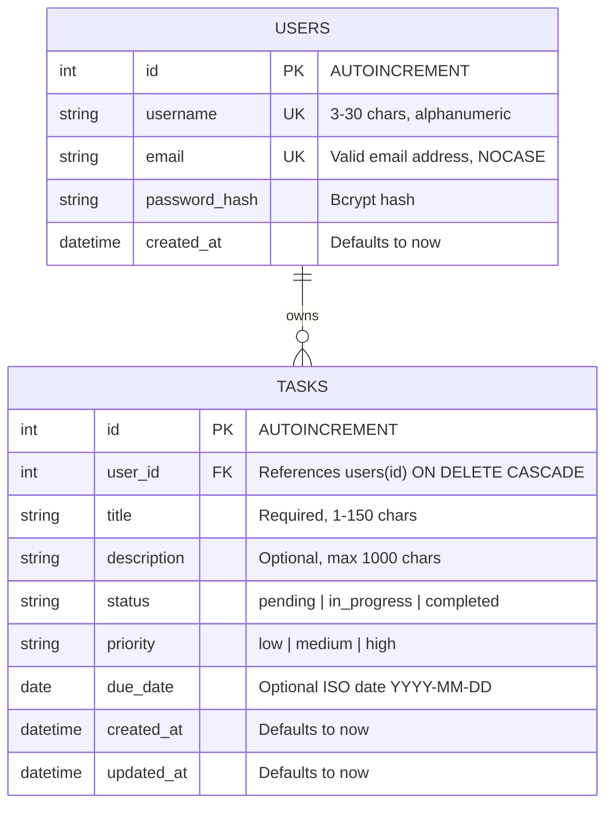

# ⚡ TaskFlow REST API

A secure, high-performance **CRUD (Create, Read, Update, Delete) REST API** built with **Node.js**, **Express**, **SQLite** (`node:sqlite`), and **JWT Authentication**.

Includes strict multi-tenant data isolation, password hashing with `bcryptjs`, comprehensive input validation on all write endpoints, 32 automated unit/integration tests, a Postman collection, and a built-in interactive web testing playground.

---

## 🌟 Key Features

- **Full CRUD Resource**: Complete task management (`/api/tasks`) with creation, listing, single-item retrieval, full replacement (`PUT`), partial updates (`PATCH`), and deletion (`DELETE`).
- **User Authentication**: Secure registration and login (`/api/auth/register`, `/api/auth/login`) with passwords hashed via `bcryptjs` (salt factor 10). Plain-text passwords or hashes are never exposed.
- **Route Protection**: JWT bearer token authentication middleware (`Authorization: Bearer <token>`). Unauthenticated or expired requests are rejected with `401 Unauthorized`.
- **Multi-Tenant Data Isolation**: Users can only query, modify, or delete their own tasks. Requests attempting to access another user's task are safely rejected with `404 Not Found` (preventing ID enumeration).
- **Comprehensive Input Validation**: Robust validation middleware checking required fields, string lengths, enum values (`status`, `priority`), and ISO date formats. Returns descriptive `400 Bad Request` messages.
- **Filtering, Sorting & Pagination**: Search tasks by substring, filter by status or priority, sort by date or title, and paginate with `page` and `limit`.
- **Live Task Aggregations**: `/api/tasks/stats/summary` endpoint returning real-time metrics (counts by status, priority, and overdue count).
- **Zero Native Build Dependencies**: Powered by Node 24's native `node:sqlite`, eliminating `node-gyp` or C++ compiler build issues on Windows/Linux/macOS.
- **Built-in Interactive Web Console**: An interactive, dark-mode Swagger-style playground and live task board served directly at `http://localhost:5000/`.
- **Automated Test Suite**: 32 tests using Node's built-in test runner (`node:test`) covering health, auth, validation, multi-tenancy, and CRUD.

---

## 🛠 Tech Stack

| Component | Technology | Description |
|---|---|---|
| **Runtime** | Node.js (v20+) | High-performance JavaScript runtime |
| **Framework** | Express (v5) | Minimalist, fast web framework |
| **Database** | SQLite (`node:sqlite`) | Embedded relational database with prepared statements |
| **Auth** | JSON Web Tokens (`jsonwebtoken`) | Stateless token-based authentication |
| **Security** | `bcryptjs` | Password hashing with adaptive salt rounds |
| **CORS** | `cors` | Cross-Origin Resource Sharing middleware |
| **Tests** | `node:test` & `node:assert/strict` | Built-in test runner and strict assertions |

---

## 📊 Data Models



---

## 🚀 Quick Start Guide

### 1. Prerequisites
- **Node.js** v20.0.0 or higher (v24 recommended).
- **npm** v10+.

### 2. Installation
Clone or navigate to the project directory:
```bash
git clone <your-repo-url>
cd task-crud-auth-api
npm install
```

### 3. Environment Variables
Copy `.env.example` to `.env`:
```bash
cp .env.example .env
```
Default configuration:
```env
PORT=5000
NODE_ENV=development
JWT_SECRET=super_secret_jwt_key_change_in_production_12345!
JWT_EXPIRES_IN=24h
DATABASE_PATH=./data/tasks.db
```

### 4. Run the Server
Start the server:
```bash
npm start
```
Or start in development mode with auto-reload:
```bash
npm run dev
```

The server will initialize SQLite tables automatically:
```
✅ SQLite Database initialized successfully.
🚀 TaskFlow REST API server is running!
📡 URL: http://localhost:5000
📚 Interactive Docs & Test Playground: http://localhost:5000/
🔒 Health Endpoint: http://localhost:5000/api/health
```

### 5. Open the Interactive Web Playground
Open your browser to:
[http://localhost:5000](http://localhost:5000)

---

## 🧪 Running Automated Tests

Run the full suite of 32 tests:
```bash
npm test
```
All tests run against an isolated test database and ephemeral server instances.

---

## 📖 API Endpoint Documentation

### Summary Table

| Method | Endpoint | Auth Required | Description |
|---|---|---|---|
| `GET` | `/api/health` | No | System health check and uptime |
| `POST` | `/api/auth/register` | No | Register a new user account |
| `POST` | `/api/auth/login` | No | Authenticate user & get JWT token |
| `GET` | `/api/auth/me` | **Yes** | Retrieve authenticated user profile |
| `GET` | `/api/tasks` | **Yes** | List user's tasks (filtered/paginated) |
| `GET` | `/api/tasks/stats/summary` | **Yes** | Aggregate task counts & metrics |
| `POST` | `/api/tasks` | **Yes** | Create a new task |
| `GET` | `/api/tasks/:id` | **Yes** | Fetch single task by ID |
| `PUT` | `/api/tasks/:id` | **Yes** | Full update of existing task |
| `PATCH` | `/api/tasks/:id` | **Yes** | Partial update of task fields |
| `DELETE` | `/api/tasks/:id` | **Yes** | Delete task by ID |

---

### Authentication Headers
For all protected routes, include the JWT token in the `Authorization` header:
```http
Authorization: Bearer <your_jwt_token_here>
```

---

### 1. Health Check
`GET /api/health`

**Response (`200 OK`):**
```json
{
  "status": "healthy",
  "timestamp": "2026-10-16T10:15:00.000Z",
  "uptime": 12.34
}
```

---

### 2. Register User
`POST /api/auth/register`

Creates a new user, hashes their password with bcrypt, and returns the sanitized user profile along with a JWT token.

**Request Body:**
```json
{
  "username": "alex_dev",
  "email": "alex@example.com",
  "password": "password123"
}
```

**Validation Rules:**
- `username`: Required, 3–30 characters, alphanumeric and underscores only.
- `email`: Required, valid email format.
- `password`: Required, minimum 6 characters.

**Success Response (`201 Created`):**
```json
{
  "success": true,
  "message": "User registered successfully.",
  "data": {
    "user": {
      "id": 1,
      "username": "alex_dev",
      "email": "alex@example.com",
      "createdAt": "2026-10-16 10:15:00"
    },
    "token": "eyJhbGciOiJIUzI1NiIsInR5cCI6IkpXVCJ9..."
  }
}
```

**Error Responses:**
- `400 Bad Request`:
  ```json
  {
    "success": false,
    "error": "Validation Error",
    "message": "Validation failed for one or more fields.",
    "errors": [
      { "field": "email", "message": "Please provide a valid email address." },
      { "field": "password", "message": "Password must be at least 6 characters long." }
    ]
  }
  ```
- `409 Conflict`:
  ```json
  {
    "success": false,
    "error": "Conflict",
    "message": "An account with this email address already exists."
  }
  ```

---

### 3. User Login
`POST /api/auth/login`

Authenticates a user using email or username and password.

**Request Body:**
```json
{
  "identifier": "alex@example.com",
  "password": "password123"
}
```
*(You can also use `"identifier": "alex_dev"`)*

**Success Response (`200 OK`):**
```json
{
  "success": true,
  "message": "Login successful.",
  "data": {
    "user": {
      "id": 1,
      "username": "alex_dev",
      "email": "alex@example.com",
      "createdAt": "2026-10-16 10:15:00"
    },
    "token": "eyJhbGciOiJIUzI1NiIsInR5cCI6IkpXVCJ9..."
  }
}
```

**Error Responses:**
- `401 Unauthorized`:
  ```json
  {
    "success": false,
    "error": "Unauthorized",
    "message": "Invalid credentials. Please verify your email/username and password."
  }
  ```

---

### 4. Get Current User Profile
`GET /api/auth/me` *(Protected)*

Returns the authenticated user's details decoded from the JWT token.

**Headers:**
```http
Authorization: Bearer <token>
```

**Success Response (`200 OK`):**
```json
{
  "success": true,
  "data": {
    "user": {
      "id": 1,
      "username": "alex_dev",
      "email": "alex@example.com",
      "createdAt": "2026-10-16 10:15:00"
    }
  }
}
```

---

### 5. List Tasks
`GET /api/tasks` *(Protected)*

Lists all tasks belonging to the authenticated user.

**Optional Query Parameters:**
- `status`: Filter by status (`pending`, `in_progress`, `completed`).
- `priority`: Filter by priority (`low`, `medium`, `high`).
- `search`: Filter tasks whose `title` or `description` contains the search query.
- `sortBy`: Field to sort by (`createdAt`, `updatedAt`, `dueDate`, `priority`, `title`). Default: `createdAt`.
- `order`: Sort direction (`ASC` or `DESC`). Default: `DESC`.
- `page`: Page number (integer >= 1). Default: `1`.
- `limit`: Number of items per page (1–100). Default: `20`.

**Example Request:**
```bash
curl -X GET "http://localhost:5000/api/tasks?status=in_progress&priority=high&page=1&limit=10" \
  -H "Authorization: Bearer <token>"
```

**Success Response (`200 OK`):**
```json
{
  "success": true,
  "data": {
    "tasks": [
      {
        "id": 1,
        "userId": 1,
        "title": "Complete REST API Documentation",
        "description": "Document all endpoints with status codes and payloads",
        "status": "in_progress",
        "priority": "high",
        "dueDate": "2026-10-25",
        "createdAt": "2026-10-16 10:15:00",
        "updatedAt": "2026-10-16 10:15:00"
      }
    ],
    "pagination": {
      "total": 1,
      "limit": 10,
      "offset": 0,
      "page": 1,
      "totalPages": 1
    }
  }
}
```

---

### 6. Create Task
`POST /api/tasks` *(Protected)*

Creates a new task linked to the authenticated user.

**Request Body:**
```json
{
  "title": "Build CRUD Endpoints",
  "description": "Implement GET, POST, PUT, PATCH, and DELETE with SQLite",
  "status": "in_progress",
  "priority": "high",
  "dueDate": "2026-10-25"
}
```

**Validation Rules:**
- `title`: Required string, 1–150 characters.
- `description`: Optional string, max 1000 characters.
- `status`: Optional enum (`pending`, `in_progress`, `completed`). Default: `pending`.
- `priority`: Optional enum (`low`, `medium`, `high`). Default: `medium`.
- `dueDate`: Optional valid ISO date string (e.g. `2026-12-31`).

**Success Response (`201 Created`):**
```json
{
  "success": true,
  "message": "Task created successfully.",
  "data": {
    "task": {
      "id": 1,
      "userId": 1,
      "title": "Build CRUD Endpoints",
      "description": "Implement GET, POST, PUT, PATCH, and DELETE with SQLite",
      "status": "in_progress",
      "priority": "high",
      "dueDate": "2026-10-25",
      "createdAt": "2026-10-16 10:15:00",
      "updatedAt": "2026-10-16 10:15:00"
    }
  }
}
```

**Error Response (`400 Bad Request`):**
```json
{
  "success": false,
  "error": "Validation Error",
  "message": "Validation failed for one or more fields.",
  "errors": [
    { "field": "title", "message": "Title is required and cannot be empty." }
  ]
}
```

---

### 7. Get Task by ID
`GET /api/tasks/:id` *(Protected)*

Retrieves a single task by its integer ID.

**Success Response (`200 OK`):**
```json
{
  "success": true,
  "data": {
    "task": {
      "id": 1,
      "userId": 1,
      "title": "Build CRUD Endpoints",
      "description": "Implement GET, POST, PUT, PATCH, and DELETE with SQLite",
      "status": "in_progress",
      "priority": "high",
      "dueDate": "2026-10-25",
      "createdAt": "2026-10-16 10:15:00",
      "updatedAt": "2026-10-16 10:15:00"
    }
  }
}
```

**Error Responses:**
- `404 Not Found` (Task does not exist or belongs to another user):
  ```json
  {
    "success": false,
    "error": "Not Found",
    "message": "Task with ID 1 was not found."
  }
  ```
- `400 Bad Request` (Invalid ID parameter):
  ```json
  {
    "success": false,
    "error": "Invalid Parameter",
    "message": "Task ID must be a positive integer."
  }
  ```

---

### 8. Full Update (PUT)
`PUT /api/tasks/:id` *(Protected)*

Replaces all editable fields of an existing task. Requires `title`.

**Request Body:**
```json
{
  "title": "Build CRUD Endpoints (Refined)",
  "description": "All endpoints tested with 100% pass rate",
  "status": "completed",
  "priority": "high",
  "dueDate": "2026-10-20"
}
```

**Success Response (`200 OK`):**
```json
{
  "success": true,
  "message": "Task updated successfully.",
  "data": {
    "task": {
      "id": 1,
      "userId": 1,
      "title": "Build CRUD Endpoints (Refined)",
      "description": "All endpoints tested with 100% pass rate",
      "status": "completed",
      "priority": "high",
      "dueDate": "2026-10-20",
      "createdAt": "2026-10-16 10:15:00",
      "updatedAt": "2026-10-16 10:20:00"
    }
  }
}
```

---

### 9. Partial Update (PATCH)
`PATCH /api/tasks/:id` *(Protected)*

Updates only the specific fields provided in the body (e.g. toggling status).

**Request Body:**
```json
{
  "status": "completed"
}
```

**Success Response (`200 OK`):**
```json
{
  "success": true,
  "message": "Task updated successfully.",
  "data": {
    "task": {
      "id": 1,
      "userId": 1,
      "title": "Build CRUD Endpoints",
      "description": "Implement GET, POST, PUT, PATCH, and DELETE with SQLite",
      "status": "completed",
      "priority": "high",
      "dueDate": "2026-10-25",
      "createdAt": "2026-10-16 10:15:00",
      "updatedAt": "2026-10-16 10:22:00"
    }
  }
}
```

**Error Response (`400 Bad Request` if empty):**
```json
{
  "success": false,
  "error": "Validation Error",
  "message": "At least one field to update must be provided (title, description, status, priority, or dueDate)."
}
```

---

### 10. Delete Task
`DELETE /api/tasks/:id` *(Protected)*

Permanently deletes a task belonging to the authenticated user.

**Success Response (`200 OK`):**
```json
{
  "success": true,
  "message": "Task deleted successfully.",
  "data": {
    "id": 1,
    "title": "Build CRUD Endpoints"
  }
}
```

**Error Response (`404 Not Found`):**
```json
{
  "success": false,
  "error": "Not Found",
  "message": "Task with ID 1 was not found."
}
```

---

### 11. Task Statistics Summary
`GET /api/tasks/stats/summary` *(Protected)*

Returns aggregated counts across all tasks for the authenticated user.

**Success Response (`200 OK`):**
```json
{
  "success": true,
  "data": {
    "stats": {
      "total": 5,
      "byStatus": {
        "pending": 2,
        "in_progress": 2,
        "completed": 1
      },
      "byPriority": {
        "low": 1,
        "medium": 2,
        "high": 2
      },
      "overdue": 0
    }
  }
}
```

---

## 📬 Postman & Insomnia Collection

A complete, pre-configured collection file is included in the project:
[`postman_collection.json`](./postman_collection.json)

### How to Import:
1. Open **Postman** (or **Insomnia**).
2. Click **Import** -> Select `postman_collection.json`.
3. The collection includes automatic token capture: when you execute **Register** or **Login**, the `authToken` variable is saved automatically and injected into subsequent protected requests!

---

## 🔒 Security Best Practices Implemented

1. **Password Hashing**: Passwords hashed using `bcryptjs` with salt factor 10.
2. **Multi-Tenant Ownership Isolation**: All task queries enforce `WHERE user_id = ?`. Users cannot read, modify, or delete tasks belonging to others.
3. **Prepared Statements**: All SQLite operations use prepared statements (`db.prepare(...)`), preventing SQL injection attacks.
4. **Token Expiration**: Configurable JWT expiration (`24h`).
5. **No Password Exposure**: Password hashes are strictly omitted from all JSON responses.
6. **Input Sanitization**: Strings are trimmed, emails checked against regex, enum fields validated against whitelists.

---

## 🌐 Public Git Repository Setup

To push this project to a public GitHub repository:

```bash
# Initialize git repository
git init

# Add files
git add .

# Initial commit
git commit -m "feat: complete CRUD REST API with JWT auth and SQLite"

# Add remote repository (replace with your GitHub URL)
git remote add origin https://github.com/<your-username>/task-crud-auth-api.git

# Set main branch and push
git branch -M main
git push -u origin main
```

---

## 📄 License
This project is open-source and available under the [MIT License](LICENSE).
